<div align="center">


# Cyber Eye

**Rule-Based Intrusion Detection System using Honeypot and IPS**

An end-to-end network security lab: attacks are generated, detected by an inline Suricata IPS, captured by honeypots,
enriched and stored in the Elastic Stack, visualised in Grafana and Kibana, and escalated by email — all behind a secure web portal.


[](https://cyber-eye.abdstpro.workers.dev)
[](https://youtu.be/6JnpEV_RBdA)

<sub>Graduation project · CYS 499 · Department of Information Technology, Yarmouk University · Fall 2025/2026</sub>

</div>

---

## Contents

- [Overview](#overview)
- [Live demo](#live-demo)
- [Demo video](#demo-video)
- [Downloads](#downloads)
- [Screenshots](#screenshots)
- [Architecture](#architecture)
- [Features](#features)
- [Tech stack](#tech-stack)
- [Getting started](#getting-started)
- [Services and ports](#services-and-ports)
- [Project structure](#project-structure)
- [Documentation](#documentation)
- [Security notes](#security-notes)
- [Team](#team)

## Overview

Cyber Eye bridges the gap between theory and hands-on security practice. It simulates a modern enterprise network in **PNETLab** — a hierarchical core / distribution / access design with **OSPF** inside, **BGP** at the edge, **NAT** and a **FortiGate** perimeter firewall — and layers a full detection and response pipeline on top:

1. **Attack generation** — a custom Python traffic generator emulates port scans, TCP SYN floods, ICMP floods and suspicious HTTP requests from an isolated attacker network.
2. **Detection and prevention** — **Suricata** runs inline as a rule-based IDS/IPS (Emerging Threats Open plus custom rules) and blocks malicious traffic in real time.
3. **Deception** — the **T-Pot** honeypot platform exposes multiple Docker-based honeypots to capture attacker behaviour.
4. **Telemetry pipeline** — Suricata EVE JSON logs are shipped by **Filebeat** to **Logstash**, enriched with **GeoIP**, and indexed in **Elasticsearch**.
5. **Visibility** — **Grafana** security dashboards and **Kibana** search give analysts live and historical views of every event.
6. **Alerting** — **Grafana Alerting** rules fire through **Alertmanager**, which delivers branded HTML email notifications.
7. **Portal** — a web portal (Nginx + React dashboard + Flask API + MySQL) provides authenticated, single-entry access to the whole stack.

This repository contains the monitoring and portal stack (Docker Compose) and the full network configuration reference. The complete lab — network, IPS, honeypot and attack generator — is available as a ready-to-run virtual machine (see [Downloads](#downloads)).

## Live demo

**[cyber-eye.abdstpro.workers.dev](https://cyber-eye.abdstpro.workers.dev)** — a public, static version of the portal: sign in with **Explore the live demo**, browse the dashboard and the team page, and open the platform tour with real screenshots of Grafana, Kibana and Alertmanager. Live authentication and real-time data require the full Docker stack ([Getting started](#getting-started)).

## Demo video

<p align="center">
  <a href="https://youtu.be/6JnpEV_RBdA"></a>
  <br>
  <sub>Click to watch the full walkthrough on YouTube</sub>
</p>

## Downloads

| Resource | Size | Link |
|---|---|---|
| **Complete lab virtual machine** (OVA in a RAR archive) | 30.6 GB | [Download from MEGA](https://mega.nz/file/xmcUURpC#yNQdEx5EGvZFruNiqrdvPxRyJvLDVcFidfqLam0Ryns) |
| **Project documentation** (PDF, 90 pages) | 3 MB | [Latest release](../../releases/latest) |
| **Presentation** (PowerPoint) | 72 MB | [Latest release](../../releases/latest) |
| **Demo video** | 92 MB | [YouTube](https://youtu.be/6JnpEV_RBdA) · [MP4 in latest release](../../releases/latest) |

### What's inside the lab VM

The OVA is the complete Cyber Eye environment, ready to run:

- **PNETLab enterprise network** — the full topology, pre-configured: ISP and attacker routers, edge router R5, core routers R1–R4, Layer 3 switches A and B, access switches 1–4, the attacker and honeypot switches, and the **FortiGate** firewall ([every configuration is documented here](docs/network/device-configurations.md)).
- **Suricata IPS** — installed and running inline with Emerging Threats Open and custom rules, writing EVE JSON logs.
- **T-Pot honeypot** — the multi-honeypot platform on the honeypot segment.
- **Python attack generator** — the attack-emulation scripts on the attacker network (port scans, SYN floods, ICMP floods, suspicious HTTP requests).

### Using the VM

1. Download the archive from MEGA (the MEGA desktop app is recommended for a file this size).
2. Extract it with [7-Zip](https://www.7-zip.org/) or WinRAR. Make sure the drive has enough free space for both the archive and the extracted OVA.
3. Import the `.ova` into **VMware Workstation** (*File → Open*) or **VirtualBox** (*File → Import Appliance*).
4. Give the VM as much RAM and as many CPU cores as your host allows, then start it and open the PNETLab lab.
5. Run the monitoring stack from this repository ([Getting started](#getting-started)) to receive and visualise the lab's events.

## Screenshots

### Web portal

| Sign-in | Portal home |
|:---:|:---:|
| 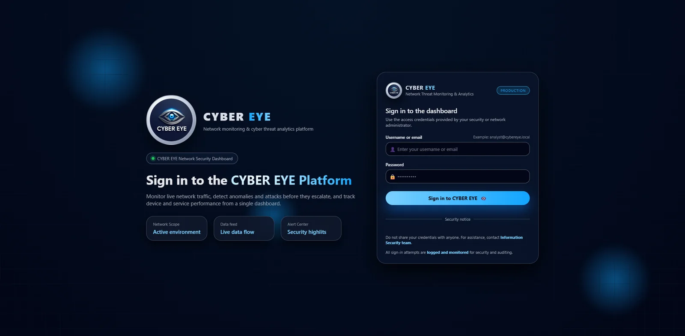 | 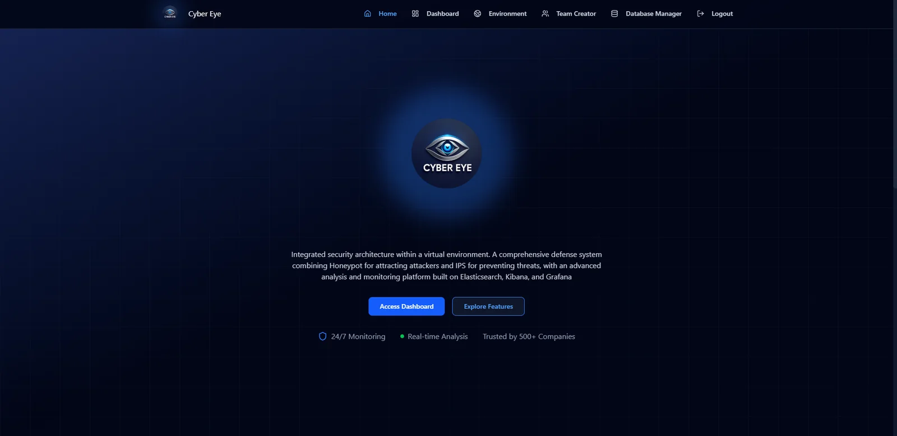 |
| **Security architecture** | **Project team** |
| 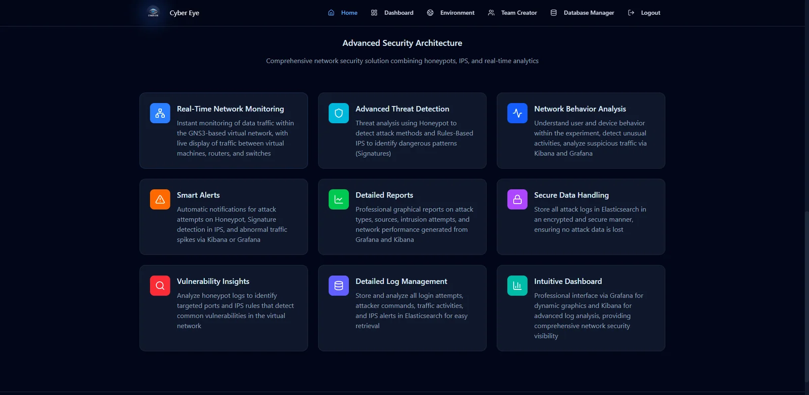 | 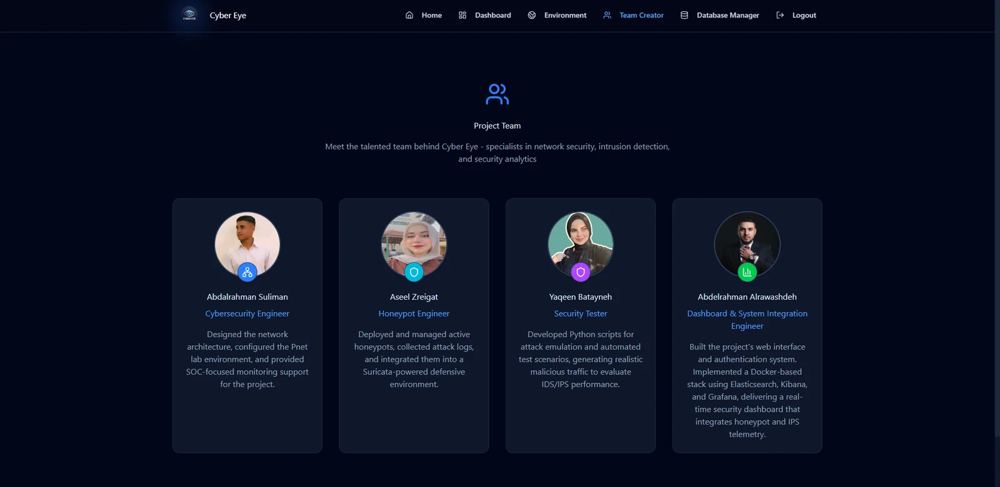 |

### Grafana security operations

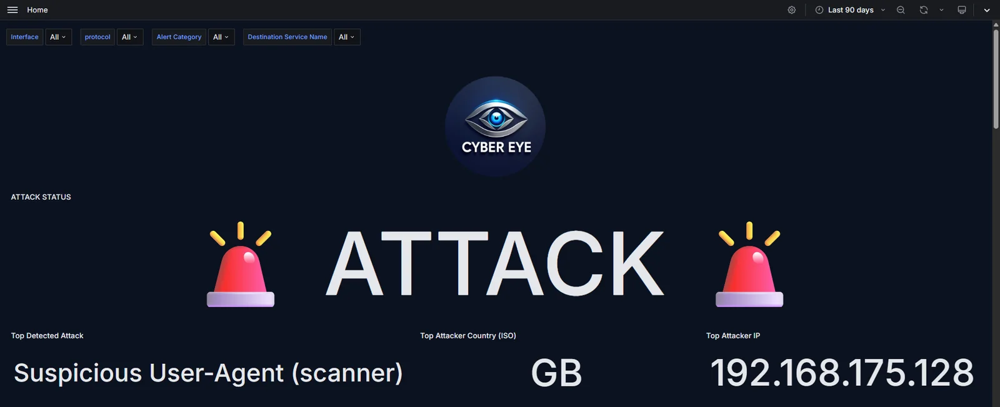

| Attack sources | Most-targeted hosts |
|:---:|:---:|
| 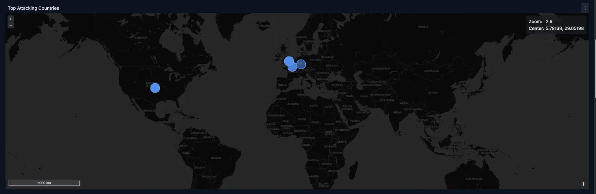 | 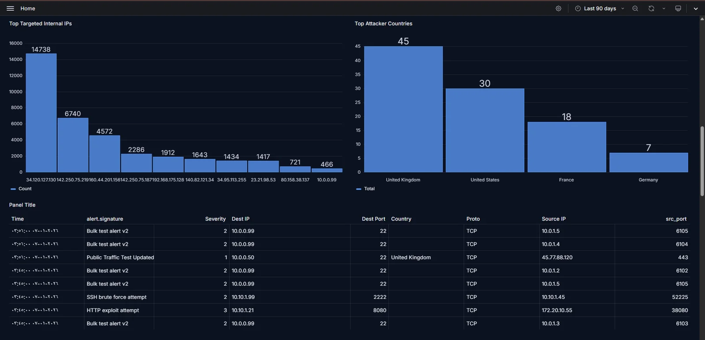 |
| **Services and signatures** | **Ports and protocols** |
| 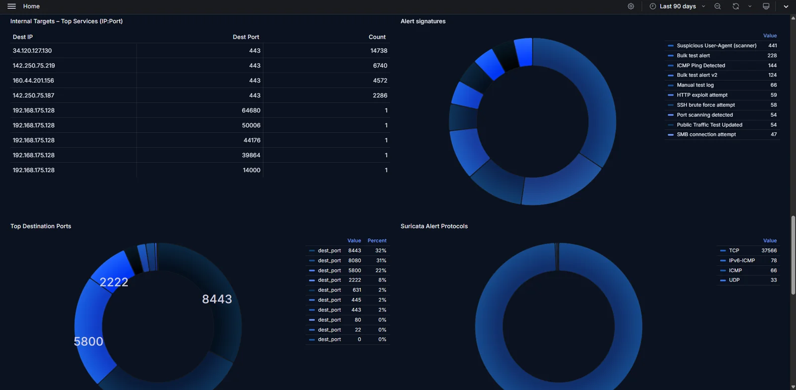 | 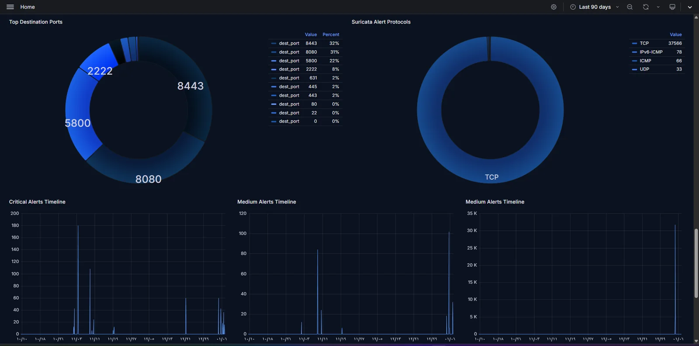 |

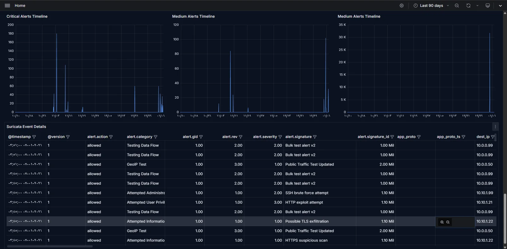

### Kibana and alerting

| Kibana Discover | Alertmanager | Alert email |
|:---:|:---:|:---:|
| 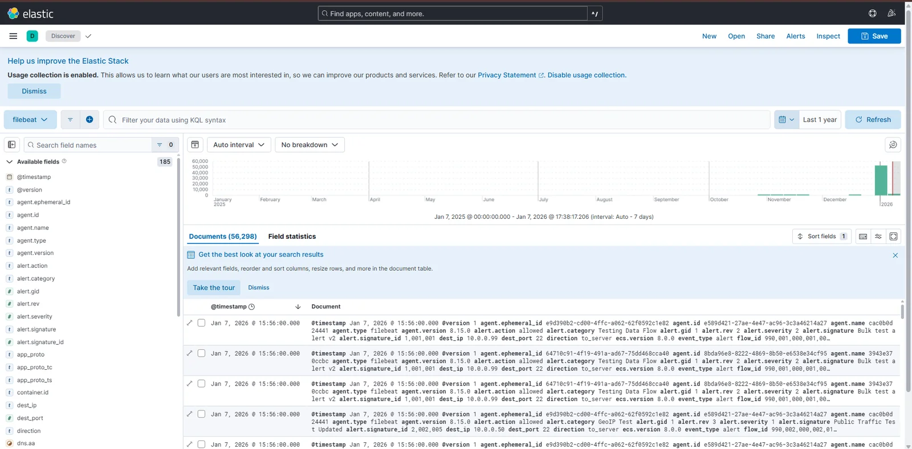 | 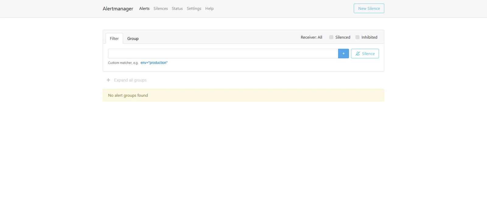 | 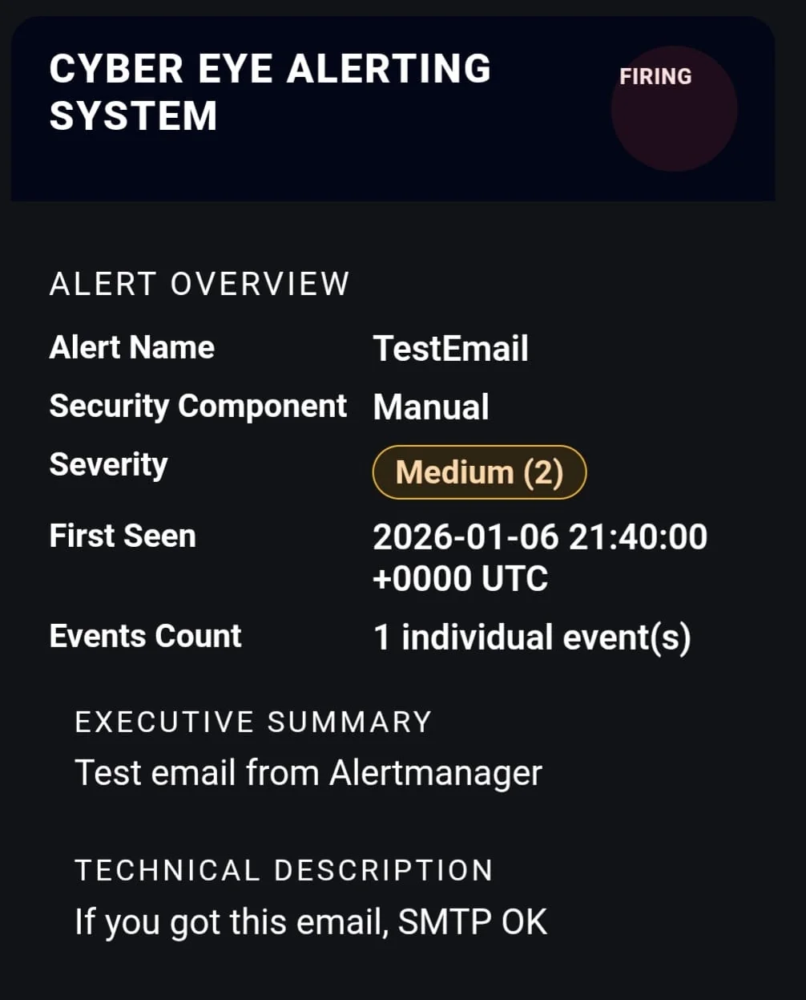 |

### Lab network topology

<p align="center">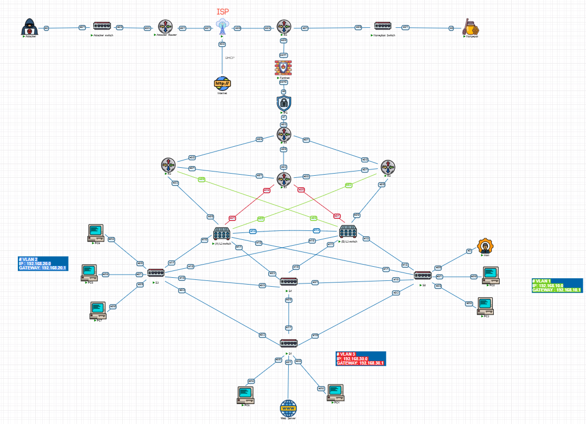</p>

## Architecture

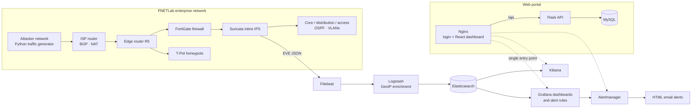

## Features

- **Inline intrusion prevention** — Suricata inspects and blocks traffic in real time using community and custom rules.
- **Honeypot telemetry** — T-Pot captures attacker techniques on exposed decoy services.
- **GeoIP enrichment** — Logstash adds attacker geolocation to every event for country-level analysis and the attack map.
- **Security operations dashboard** — attack status, attacker countries, targeted hosts and services, port / protocol distribution, severity timelines and full Suricata event details.
- **Automated alerting** — a provisioned Grafana rule raises *High Suricata Alerts Rate* when more than 5 alerts arrive within 5 minutes; Alertmanager groups, de-duplicates and emails them with a branded HTML template.
- **Secure portal** — sign-in backed by MySQL with SHA-256 password hashing enforced by database triggers, session-scoped access and a unified navigation bar to Grafana, Kibana, Alertmanager and the database manager.
- **Infrastructure as code** — every datasource, dashboard and alert rule is provisioned from files, so the stack comes up fully configured.
- **One-command operations** — `poweron.ps1` / `poweroff.ps1` start Docker Desktop, bring the stack up or down and open the portal.

## Tech stack

| Layer | Technology |
|---|---|
| Network lab | PNETLab · Cisco IOS routers and switches · OSPF · BGP · NAT · VLANs · FortiGate |
| Detection | Suricata IDS/IPS (inline) · Emerging Threats Open rules · custom rules |
| Deception | T-Pot honeypot platform |
| Log pipeline | Filebeat · Logstash (GeoIP) · Elasticsearch 8.15 |
| Visualisation | Grafana 11.2 · Kibana 8.15 · Boom Theme panel |
| Alerting | Grafana Alerting · Alertmanager 0.27 · SMTP |
| Portal | Nginx · React dashboard · HTML/CSS/JS sign-in · Flask 3 + Gunicorn · MySQL 8 · Adminer |
| Attack simulation | Python |
| Operations | Docker Compose · PowerShell |

## Getting started

### Prerequisites

- Docker Desktop (or Docker Engine) with Compose v2
- 8 GB of RAM recommended (the Elastic Stack alone reserves about 2.5 GB)
- A data source that ships Suricata EVE JSON to Logstash on port `5044` (Filebeat in the lab)

### Run

```bash
git clone https://github.com/Abdelrahman-Alrawashdeh/cyber-eye.git
cd cyber-eye

cp .env.example .env                                            # then edit the values
cp alertmanager/alertmanager.example.yml alertmanager/alertmanager.yml   # then add your SMTP settings

docker compose up -d --build
```

Open the portal at **http://localhost:5173/login/**.

On Windows, `poweron.ps1` and `poweroff.ps1` automate the same steps using the paths in `.env`.

### Useful commands

```bash
docker compose ps                     # service status
docker compose logs -f alertmanager   # follow a service
docker compose restart grafana        # reload provisioned dashboards
docker compose down                   # stop the stack
```

## Services and ports

| Service | URL / port | Purpose |
|---|---|---|
| Portal (Nginx) | http://localhost:5173 | Sign-in and dashboard; proxies `/api` to the backend |
| Flask API | http://localhost:5000 | Authentication and health checks (`/health`, `/health/db`) |
| Grafana | http://localhost:3000 | Security dashboards and alert rules |
| Kibana | http://localhost:5601 | Log search and investigation |
| Elasticsearch | http://localhost:9200 | Event storage (`filebeat-*` indices) |
| Logstash | `5044` (Beats) · `9600` (API) | Ingestion and GeoIP enrichment |
| Alertmanager | http://localhost:9093 | Alert routing and email delivery |
| MySQL | `3307` | Portal users |
| Adminer | http://localhost:8081 | Database administration |

## Project structure

```
cyber-eye/
├── docker-compose.yml          # the full monitoring and portal stack
├── .env.example                # environment template (copy to .env)
├── poweron.ps1 / poweroff.ps1  # Windows start / stop automation
├── alertmanager/
│   ├── alertmanager.example.yml
│   ├── templates/email.tmpl    # branded HTML alert email
│   └── assets/                 # logo used by the template
├── logstash/pipeline/          # Beats input → GeoIP → Elasticsearch
├── provisioning/
│   ├── datasources/            # Elasticsearch + Alertmanager
│   ├── dashboards/             # dashboard provider
│   └── alerting/rules.yml      # High Suricata Alerts Rate rule
├── grafana-data/dashboards/    # Cyber Eye security dashboard (JSON)
├── web/
│   ├── Dockerfile · nginx.conf # static frontend + /api reverse proxy
│   ├── frontend/               # login page, React dashboard build, assets
│   ├── backend/                # Flask API (app.py, Dockerfile, requirements)
│   └── mysql-init/             # schema, hashing triggers, seed admin
├── demo/                       # static public demo, live at cyber-eye.abdstpro.workers.dev
├── wrangler.jsonc              # Cloudflare deployment config for demo/
└── docs/
    ├── screenshots/
    └── network/                # topology + device configurations
```

## Documentation

- **Network device configurations** — every router, switch and firewall command with explanations: [`docs/network/device-configurations.md`](docs/network/device-configurations.md)
- **Full project report** (90 pages: network design, Suricata, T-Pot, attack generator, ELK pipeline, Grafana and alerting) — PDF in the [latest release](../../releases/latest)
- **Demo video** — [watch on YouTube](https://youtu.be/6JnpEV_RBdA)
- **Presentation** — attached to the [latest release](../../releases/latest)
- **Lab virtual machine** — see [Downloads](#downloads)

## Security notes

This is a **lab environment** built for education and controlled testing. Before running it anywhere other than an isolated lab, read [`SECURITY.md`](SECURITY.md): Elasticsearch security is disabled, several services publish ports on the host, and the seeded accounts use development defaults that must be changed.

## Team

| Member | Role |
|---|---|
| **Abdelrahman Alrawashdeh** | Dashboard & System Integration Engineer — web portal, authentication, Docker-based Elastic / Grafana stack and real-time security dashboard |
| **Abdalrahman Suliman** | Cybersecurity Engineer — network architecture, PNETLab environment and SOC monitoring |
| **Aseel Zreigat** | Honeypot Engineer — T-Pot deployment, attack log collection and Suricata integration |
| **Yaqeen Batayneh** | Security Tester — Python attack emulation and automated IDS/IPS test scenarios |

Supervised by **Dr. Malek Barhoush** · Faculty of Information Technology and Computer Sciences, Yarmouk University.
